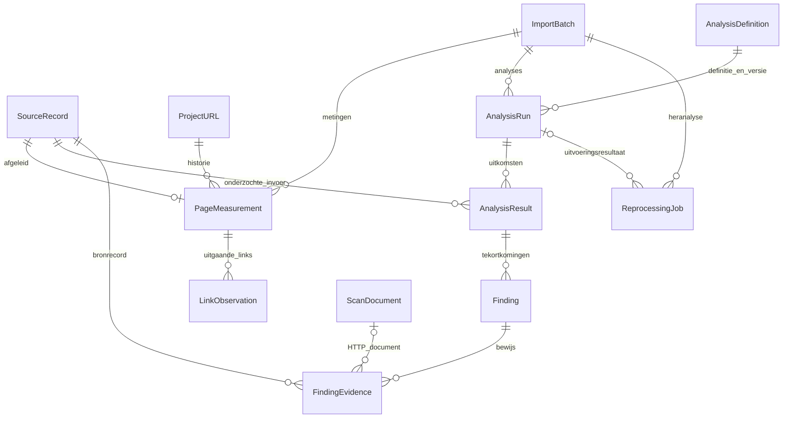

# Stap 1 — crawlmetingen, links en bewijsbare analyses

Datum: 3 november 2026. Implementatie van de eerste verticale keten uit
[de crawlereisen](08-crawler-assessment-eisen.md). Privacyonderzoek, leveranciersherkenning en categoriescores behoren tot volgende
stappen. Browserrendering is inmiddels gerealiseerd in [stap 2](10-browseronderzoek.md).

## Opslagconcept en gerealiseerde modellen

De oorspronkelijke `ImportBatch`, `SourceRecord`, `ScanDocument`, `ProjectURL`
en `URLObservation` blijven bestaan. Nieuwe modellen staan in `assessments/models.py`.



- `PageMeasurement`: getypeerde status, eindstatus, URL, tijd, indexeerbaarheid,
  woordtelling, responstijd, diepte en teksthash; aanvullende facts en dekking in JSONB.
- `LinkObservation`: bronmeting, positie, genormaliseerde bestemming en SHA-256,
  ankertekst, rel en locator. Herhaalde links blijven behouden. Geen nieuwe
  URL-catalogusitems voor uitsluitend ontdekte, niet bezochte bestemmingen.
- `AnalysisDefinition`: versieerbare vraag/controle, methode en antwoordstructuur.
- `AnalysisRun`: gebruikte batch, extractor-/regelversie, begin/eindtijd,
  dekking, status en aantallen per regel.
- `AnalysisResult`: één resultaat per bronrecord, ook zonder tekortkoming.
  Uitkomst is issue, pass, unknown of not_applicable. Bewaart de gebruikte
  paginavelden als snapshot en de meet-/extractietijd.
- `Finding`: regel, ernst, beschrijving, actie, details en beoordelingsstatus.
- `FindingEvidence`: verwijzing naar bronrecord, optioneel HTTP-document,
  bewijsrol en snapshot. Een 404-link heeft bewijs voor bron én bestemming.
- `ReprocessingJob`: uitvoerende gebruiker, batch, status, fout en resulterende analyse.
  Per batch maximaal één actieve heranalyse; rechten worden bij uitvoering hercontroleerd.

Dit fundament ondersteunt latere AI-analyses zonder AI-antwoorden met HTTP-feiten te
vermengen. Vrije AI-vragen, modelconnectoren en generieke AI-outputvalidatie zijn nog
niet geïmplementeerd. Technologie-/leveranciersmodellen zijn eveneens vervolgwerk.

## Indexering en publicatie

PostgreSQL bewaart getypeerde velden en JSONB. Indexen bedienen batch/status,
batch/URL, batch/teksthash, URL/meettijd, linkbestemming, analysedatum en regel/ernst.
De bronrecordrelaties en unieke record-/linkposities zijn ook geïndexeerd.

Geen brede GIN-index op alle ruwe brondata: de gerealiseerde vragen gebruiken
getypeerde tabellen, FK-indexen en beperkte batchanalyses. Nieuwe JSON-filters krijgen
pas een gerichte index wanneer queryvorm en queryplan daarvoor aanleiding geven.

Een expressie-index op `ScanDocument(batch_id, md5(url))` ondersteunt historische
herextractie zonder lange URL's als B-tree-sleutel op te slaan. De query controleert
ook de volledige URL; de digest is een lookup-hulpmiddel, geen unieke identiteit.
HTML-bodies staan in deze versie nog als binaire velden in PostgreSQL. Migratie naar
privébestands-/objectopslag is niet onderdeel van deze stap.

Schrijven en analyseren gebeurt in begrensde chunks. Publicatie is transactioneel.
Nieuwe crawls krijgen automatisch een analyse nadat bronrecords, documenten en
terminale crawlstatus bekend zijn. Herindexering herbouwt paginametingen en links;
eerdere analyses met snapshots en bronbewijs blijven bewaard. Iedere expliciete
heranalyse krijgt een eigen run. Dubbele levering van dezelfde heranalysetaak
maakt geen extra run. Batchverwijdering verwijdert ook afgeleide data en analyses.

## Extractie en meetkwaliteit

Nieuwe crawls bewaren naast de bestaande uitgaande URL's ook ankertekst, rel,
linkpositie, aantal gevonden links en een expliciete vlag bij de grens van 2.000
links. Robots-meta-instructies krijgen hun bron en doelgroep mee; de bestaande
technische indexeerbaarheidsberekening is hiermee nog niet volledig herzien.

Oude crawls kunnen lokale opgeslagen HTML herlezen zonder netwerkrequests.
Oorspronkelijke bronrecords en meettijd blijven ongewijzigd; extractietijd en versie
worden apart opgeslagen. Headers die vroeger niet zijn bewaard worden niet verzonnen;
oorspronkelijke robots-/indexeerbaarheidsfeiten blijven behouden.

Dekking vermeldt onbekende links, ontbrekende detailgegevens, afkapping, herstelde
documenten en oorspronkelijke scanstatus/waarschuwingen. Externe en niet bezochte
bestemmingen zijn niet als bereikbaar beoordeeld. Linkcontrole gebruikt uitsluitend
bestemmingsmetingen uit dezelfde batch. Redirects met eindstatus 404 zijn herkenbaar
naast directe 404's. Mailto-, fragmentloze niet-HTTP- en ongeldige URL-identiteiten
worden niet als HTTP-linkmeting opgenomen; genegeerde links worden geteld.

## Gerealiseerde controles en ontsluiting

- Ontbrekende en meervoudige titels, meta descriptions en H1-koppen.
- Dubbele eerste titels/descriptions na witruimtenormalisatie en casefolding.
- Exact gelijke paginatekst op verschillende finale URL's, op basis van teksthash.
- Links naar een gemeten 404, inclusief redirects die op 404 eindigen.

Deze signalen vragen interpretatie; meerdere H1's of dezelfde paginatekst zijn niet
in iedere situatie fout. De huidige tekstextractie bevat navigatie en CSS-verborgen
tekst. Dit is geen bijna-duplicaatanalyse of browsermeting.

Projecttab **Bevindingen** biedt heranalyse, analysehistorie, dekking, filters op
controle/ernst/bron-URL en drilldown naar bronrecords en beschikbare HTTP-documenten.
Het URL-dossier verwijst naar de getypeerde crawlmeting en gepagineerde
inkomende/uitgaande links. Analyse-export is JSONL met runmetadata, alle resultaten,
bevindingen en bewijsverwijzingen. De bestaande brondata-export blijft afzonderlijk.
Lezers kunnen bekijken/exporteren; bewerkers en beheerders kunnen heranalyse starten.

## Beheercommando's

Gebruik uitsluitend de gewenste omgeving en bijbehorende migratierol. Voor test:

```sh
docker compose --profile tools run --rm migrate python manage.py migrate --noinput
docker compose --profile tools run --rm migrate python manage.py analyze_crawls --batch UUID --recover-documents
docker compose --profile tools run --rm migrate python manage.py analyze_crawls --project UUID --recover-documents
```

`reindex_urls --project UUID --recover-documents` herbouwt ook URL-observaties.
`analyze_crawls` gebruikt de reeds gekoppelde URL-observaties. Geen van deze
commando's bezoekt de website. Heranalyses krijgen een afzonderlijk meetrapport.

## Validatie

Nieuwe tests controleren extractie, caps, directe/geredirecte 404's, batchisolatie,
metadata/duplicaten, historische herextractie, meetdatums, rollback, verwijdering,
projectrechten, CSRF, queuefouten, dubbele taaklevering, bewijsweergave en export.

Synthetische schaalproef (testmigratierol, geen netwerkrequests, data teruggedraaid):

```sh
docker compose --profile tools run --rm -T migrate python manage.py shell < ops/checks/assessment_scale.py
```

De definitieve proef verwerkte 10.000 pagina's, 100.000 links en de analyses in 11,07 s,
met circa 104,5 MiB piek-RSS en 1.588 databasequeries. Dit meet synthetische verwerking,
geen snelheid op een externe website en geen browserperformance. Latere wijzigingen
kunnen de exacte waarden veranderen; herhaal bij relevante performancewijzigingen.


De volledige suite slaagt met 287 tests. De 11 eerder bestaande filter-/exportproblemen
zijn hersteld: onbekende bestandstypen zijn expliciet bereikbaar met een melding bij
uitsluiting door de HTML-selectie; sitestructuur kan oorspronkelijke audit/Ahrefs-data
selecteren zonder MIME-filter. Verouderde tests vragen alle bestandstypen expliciet
op en gebruiken de huidige SEMScan-broncode. Vijf aanvullende regressietests dekken
HTML-defaults, onbekende waarden, selectiedekking, sitestructuur/export en projectisolatie.
Zie [het filterbeleid](04-url-overzicht.md).

De runtimecontrole `ops/checks/assessment_smoke.py` controleert heranalyse via
UI → Redis → Celery → database, inclusief HTML-herextractie, beide bewijsdocumenten
en export. Alleen uitvoeren op sem_test; tijdelijke data wordt verwijderd.

De runtimecontrole is geslaagd op de bijgewerkte testomgeving, inclusief beide
bewijsdocumenten en export; tijdelijke gegevens zijn opgeruimd. De testservices
web, worker en scan-worker draaien de nieuwe code. Productie is niet gewijzigd.

Browserbatches leveren eveneens getypeerde paginametingen en links, met
`discovery_mode=rendered`. Bevindingen kunnen via `FindingEvidence.browser_artifact`
naar browserbewijs verwijzen. De actuele suite telt 307 geslaagde tests.

## Extractie- en regelcorrectie versie 2

`html-v3` sluit SVG-/MathML-titels uit van paginatitels; echte dubbele HTML-titels
blijven zichtbaar. `assessment-v2` / basisregels versie 2 herkennen e-maillinks
met Cloudflare-markering én hetzelfde hostpad `/cdn-cgi/l/email-protection`.
Een gemeten 404 op zo’n link blijft als bronfeit behouden, maar wordt in het
analysesamenvatting geteld als `protected_email_links` (browsercontrole nodig),
zonder harde kapotte-linkbevinding. De linkcontrole wordt daarmee onbekend,
geen pass. Ongekenmerkte links naar hetzelfde pad blijven gewone 404-bevindingen.
Heranalyse uit opgeslagen HTML maakt een nieuwe analyse en behoudt historische
resultaten en oorspronkelijke bronrecords.

De uitgebreide pagina-/relatieregels, paginaresultaten en herextractie van browser-DOM
zijn beschreven in [stap 4](13-pagina-en-relatieanalyse.md). Deze gebruikt basisregels
versie 3; oudere analyseruns blijven historische rapporten met hun eigen versie.
