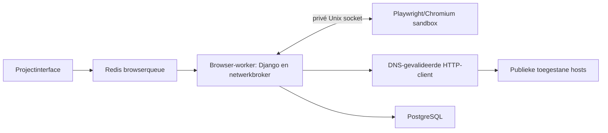

# Stap 2 — browseronderzoek, assets, toegankelijkheid en performance

Datum: 3 november 2026. Dit document beschrijft de gerealiseerde tweede stap uit
[de technische eisen](08-crawler-assessment-eisen.md). De oorspronkelijke HTML-crawl
blijft de volledige inventaris; browseronderzoek is een afzonderlijke begrensde scan.

## Gebruik

Open een gepubliceerde websitecrawl met actief scandoel en kies **Browseronderzoek
starten**, of ga via **Bevindingen → Browseronderzoek, assets en toegankelijkheid**.
Bewerkers en beheerders kunnen starten; lezers kunnen gepubliceerde resultaten bekijken.

Instellingen: maximaal 1–100 pagina's (standaard 20), desktop 1440×900 of mobiele
viewport 390×844, navigatie-/resourcewachttijd 5–60 seconden (standaard 30), maximaal
1–15 verzoeken/s per host en 1–16 gelijktijdige netwerkverzoeken, beide overgenomen uit de broncrawl. De browserinstellingen tonen deze waarden zonder afzonderlijke overschrijving. Gebruikte externe bestanden zijn toegestaan behalve bij expliciete uitsluiting.
Het verzoektempo is een bovengrens. De mobiele viewport gebruikt geen CPU-/netwerksimulatie
van een fysieke telefoon; user-agent blijft de SEM-crawler voor de netwerkrequests.

De selectie kiest eerst een URL per host/hoofdpaden uit bekende HTML-waarnemingen en
vult lexicografisch aan. Bij gebrek aan HTML-waarnemingen wordt de oorspronkelijke
start-URL gebruikt. JavaScript-links worden binnen hetzelfde paginabudget gevolgd,
maximaal drie linkstappen. Dit is een beschreven selectieheuristiek, geen bewezen
templateclassificatie. Resultaten worden niet naar ononderzochte pagina's geëxtrapoleerd.

Externe resources vereisen een expliciete hosttoelating. Dat verruimt de toegestane
hoofdnavigatiehosts niet. Geblokkeerde resources, time-outs, JavaScript-/consolefouten
en afkappingen blijven zichtbaar. De pagina blijft dan onvolledig. HTTP-fouten bij
resources leveren afzonderlijke bevindingen op. Een leeg alt-attribuut is niet
standaard als fout geclassificeerd; axe-core beoordeelt het relevante gebruik.

## Architectuur en netwerkisolatie



- `browser-worker` heeft een eigen queue, één proces, 512 MiB en één CPU.
- `browser-sandbox` heeft `network_mode: none`, geen applicatiecredentials, geen
  media-/database-/Docker-socketmount en geen gepubliceerde poorten. Alleen de
  privé Unix-socketvolume is gedeeld. De rootfilesystem is read-only, alle
  capabilities zijn verwijderd; `/tmp` en shared memory zijn begrensd.
- Chromium draait als niet-root met de eigen native sandbox ingeschakeld.
  `ops/browser-seccomp.json` is het officiële Playwright-profiel met aanvullende
  toelating van `chroot` binnen de onprivileged user namespace; er wordt geen
  containercapability toegevoegd. Startfouten schakelen de native sandbox niet uit.
- Playwright-interceptie levert ieder HTTP-verzoek aan de broker. Die controleert
  scope, DNS, alle geretourneerde IP's, poort, methode, robotsbeleid en budget.
  De verbinding wordt op een gevalideerd publiek IP vastgezet met TLS-hostvalidatie.
  Redirects worden per hop opnieuw gecontroleerd. Ook als interceptie zou worden
  omzeild, verhindert de netwerknamespace directe publieke/private verbindingen.
- Uitsluitend GET; browsercookies, autorisatie- en overige requestheaders worden
  niet doorgestuurd. Set-Cookie/gevoelige responseheaders worden niet doorgeleverd.
  Serviceworkers, WebSockets, pop-ups, downloads en formulier-/POST-verzoeken worden
  geblokkeerd. Onderzoek is publiek/stateless en bevat nog geen consentinteracties.
- Resourceverkeer telt mee in de gedeelde per-hostbegrenzer van HTTP-scans. De
  bestaande controle op projecttoegang en een actief scandoel blijft gelden.

## Grenzen en voortgang

Per browserpagina: maximaal 100 doorgegeven verzoeken, 20 MiB ontvangen/uitgepakte data
en 5 MiB per document. DOM en screenshot krijgen eveneens ieder een grens van 5 MiB.
Afbeeldingsinventaris: maximaal 500 elementen, met zichtbaar totaal/afkapping.
Toegankelijkheidsbewijs: maximaal tien elementen per overtredingsregel, met de
werkelijke telling en afkapvlag. Het protocol heeft een maximum van 32 MiB per bericht.

De renderwachttijd betreft navigatie en resourceverkeer; stabilisatiewacht en
begrensd scrollen (twee stappen standaard, maximaal drie) zijn expliciet. Browseranalyse
kan daarna doorlopen; een geïsoleerde renderjob wordt uiterlijk na 100 seconden met
alle childprocessen afgebroken. Bij zo’n hard afgebroken job herstart uitsluitend
de geïsoleerde renderercontainer, zodat ook losgemaakte browserprocessen verdwijnen. Celery heeft 120/135 seconden soft-/hardlimiet per taak.
Totale runlimiet: minimaal 120 seconden, schaalt met pagina's en renderwachttijd, maximaal
twee uur. Bewijsopslag is maximaal 256 MiB per run. Bereikte budgetten worden geen
positieve controles of verzonnen HTTP-statussen.

Eén taak verwerkt één pagina en plant de volgende taak in. De wachtrij staat duurzaam
in `BrowserVisit`; een PostgreSQL advisory lock voorkomt gelijktijdige verwerking van
dezelfde run. Late acknowledgements laten een verloren taak opnieuw leveren. Reeds
gepubliceerde runs worden niet opnieuw gepubliceerd. Een mislukte run kan via de
rapportage of de algemene batchherstart verdergaan met de opgeslagen wachtrij.
Annuleren gebruikt de bestaande projectgebonden scanactie; ingetrokken toegang
verhindert nieuwe verzoeken en publicatie. Na annuleren wordt geen nieuw rapport
gepubliceerd. De rapportage toont aantallen/statussen; voor actuele voortgang is er
vernieuwen, zonder het HTTP-crawlgrafiekje als browserpercentage te presenteren.

## Datamodel en bewijs

- `BrowserRun`: eigen SEMScan-batch (`scan=browser`), optionele oorspronkelijke
  crawl, bevroren configuratie, engineversies, sampling, dekking en tijden.
- `BrowserVisit`: URL-identiteit, diepte/ontdekking, status, meetmoment, finale URL,
  server-/renderfacts, verschillen, diagnostische metrics, fouten en dekking.
- `BrowserResource`: URL, type, methode, status/blokkade, bytes, HTTP-ophaaltijd,
  begin/eindpunt in de waterfall, contenttype en bodychecksum. Geen ruwe third-party bodies.
- `AccessibilityIssue`: axe-regel, impact, uitleg, elementselectors/HTML-fragmenten,
  foutuitleg en telling/afkapping.
- `BrowserArtifact`: server-HTML, gerenderde DOM en viewport-PNG, checksum, type,
  omvang en body. In deze versie in PostgreSQL, projectgebonden; geen publieke files.

Iedere visit krijgt bij publicatie een bronrecord en URL-observatie. Gerenderde links
komen in het bestaande geïndexeerde `PageMeasurement`/`LinkObservation`-model met
`discovery_mode=rendered`. Er komen twee versieerbare analyses: pagina-/linkcontroles
en toegankelijkheid/resources. Bevindingen verwijzen naar bronrecords en browserbewijs.
De eigen batch laat de oorspronkelijke crawl intact. Het verwijderen van die batch
verwijdert visits, resources, artefacten, afgeleide metingen en analyses. Verwijderen
van de oorspronkelijke crawl maakt alleen de bronbatchverwijzing leeg; het browseronderzoek
heeft eigen opnieuw gemeten server-/browserbewijs en blijft zelfstandig beschikbaar.

Downloads vereisen projecttoegang. HTML/DOM zijn uitsluitend bijlagen met octet-stream,
`nosniff` en een beperkende CSP. Alleen door de renderer gemaakte PNG-screenshots
kunnen inline worden getoond. Dezelfde projectgrenzen gelden voor historie en export.

## Vergelijkingen en metingen

Vergelijk server/render op titels, descriptions, H1/H2, canonicals, robots, woordtelling,
teksthash en nieuw toegevoegde links. Server-HTML en gerenderde DOM blijven beschikbaar;
DOM wordt als UTF-8 gelezen, onafhankelijk van de oorspronkelijke servercharset.
Een allowlist van relevante hoofddocumentheaders blijft in de meetdekking bewaard;
geen cookies of autorisatieheaders. User-agent, cachebeleid en device scale worden
naast engineversies vastgelegd. Robots-onzekerheid wordt niet stilzwijgend indexeerbaar. Een JavaScript-wijziging is
zichtbaar verschil, niet automatisch een tekortkoming.

Axe-core 4.14.0 voert automatische controles uit. Overtredingen worden bevindingen;
`incomplete`-regels blijven voor handmatige beoordeling en leveren geen pass op.
Dit is geen volledige WCAG-beoordeling. Contentextractie gebruikt het geserialiseerde
hoofddocument; iframe-/shadow-DOM-inhoud wordt niet als afzonderlijke pagina
geëxtraheerd. Niet uitvoerbare framecontroles blijven bij axe als onzeker herkenbaar.

Performance gebruikt bestaande Chromium Performance APIs: DOMContentLoaded/load,
FCP, waargenomen LCP/layoutverschuiving en resource-waterfall/ophaaltijden/bytes.
Native PerformanceObservers zijn vóór de pagina actief. Ontbrekende waarden blijven
onbekend. Het gaat om diagnostische labmetingen via een gevalideerde, gepacete broker:
geen Lighthouse-score, representatieve mobiele snelheid, INP of CrUX-/veld-CWV.
Er worden geen snelheidsscores of slechte-CWV-oordelen uit deze timings afgeleid.
Volwaardige Lighthouse/WebPageTest-profielen en velddata blijven afzonderlijke
uitbreidingen met hun eigen meetmethode en voorwaarden.

## Engines, deployment en validatie

Playwright 1.64.1, Chromium uit de bijbehorende officiële Python-image en lokaal
vastgelegde axe-core 4.14.0. De npm-tarball is gecontroleerd tegen SHA-512-integriteit;
licentie, bron en checksum staan in `browser_scans/vendor`. Browserversie en de
checksum van daadwerkelijk uitgevoerde axe-code worden per run vastgelegd.

Test:

```sh
docker compose build web browser-sandbox
docker compose --profile tools run --rm migrate python manage.py migrate --noinput
docker compose up -d web worker scan-worker browser-sandbox browser-worker
```

Productie gebruikt een afzonderlijke `SEM_PROD_BROWSER_IMAGE` met commit-tag.
Het deployscript bouwt deze naast de app/gateway en laat de browserworker vóór
migraties stoppen. Dit document en de wijzigingen voeren geen productiedeploy uit.

De volledige suite slaagt met 307 tests, inclusief twintig nieuwe browsertests.
De echte engineproef gebruikt synthetische publieke antwoorden en controleert
JavaScript-content/-links, axe image-alt, HTTP 404 voor een afbeelding, PNG-bewijs,
FCP/layoutmetingen en blokkering van private/POST-verzoeken, zonder externe requests:

```sh
docker compose --profile tools run --rm -T -v sem-test_browser_ipc:/run/sem-browser migrate python manage.py shell < ops/checks/browser_engine_probe.py
```

Aanvullend is op netwerklaag gecontroleerd: alleen loopback, nul effectieve
capabilities en geen TCP-toegang tot publieke hosts, private database of localhost-database.

## Referenties

- [Playwright Docker en sandboxprofiel](https://playwright.dev/python/docs/docker)
- [Playwright netwerkinterceptie](https://playwright.dev/python/docs/network)
- [Playwright route fulfil](https://playwright.dev/python/docs/api/class-route)
- [Playwright browseropties](https://playwright.dev/python/docs/api/class-browsertype)
- [axe-core](https://github.com/dequelabs/axe-core)


De aanvullende live-runtimecontrole op sem_test is geslaagd met publieke example.com:
queue → browserworker → native geïsoleerde Chromium → drie artefacten → beide analyses
→ URL-dossier/bewijsdownloads. Tijdelijke gebruikers, projecten en batches zijn verwijderd.
Het controleprogramma staat in `ops/checks/browser_runtime_smoke.py`; het doet enkele
publieke requests en mag uitsluitend op sem_test draaien. De testomgeving is bijgewerkt;
productie is niet gewijzigd.

## Aanvulling stap 3

Bovenstaande beschrijving van geen interacties/stateless transport betreft het
baselineonderzoek. [Stap 3](11-privacy-technologie.md) voegt optionele onafhankelijke
toestemmingsscenario’s toe met tijdelijke native cookies, opslagmetadata en
automatische technologie-/DNS-verrijking. Cookiewaarden komen niet in de nieuwe
opslagwaarnemingen; oorspronkelijke HTML/DOM/screenshot blijven ongeredigeerd bewijs.

## Correcties na de eerste praktijkscan

De selectie gebruikt nu alleen succesvolle HTML-waarnemingen en verdeelt het budget
roulerend over hoofdpaden en subpaden. Per URL-pad wordt één variant geselecteerd;
een URL zonder query heeft voorrang. `/cdn-cgi/`-infrastructuur valt buiten de
browserselectie. Ook nieuw ontdekte browserlinks herhalen geen reeds onderzocht pad.
Dit vergroot templatevariatie, maar bewijst geen volledige templatedekking.

Uit opgeslagen server-HTML van de geselecteerde pagina’s worden maximaal twintig
exacte resource-subdomeinen van de toegestane websitehosts toegevoegd. Dit maakt
bijvoorbeeld `analytics.website.nl` bereikbaar zonder de navigatiescope uit te
breiden. Externe domeinen vereisen nog expliciete invoer. Iedere request behoudt
publieke DNS-validatie en IP-pinning. De concrete automatisch toegevoegde hosts
staan apart in `discovered_resource_hosts`. De broncrawl wordt daarvoor niet opnieuw
bezocht. Privacyonderzoek blijft een afzonderlijke expliciete keuze.
