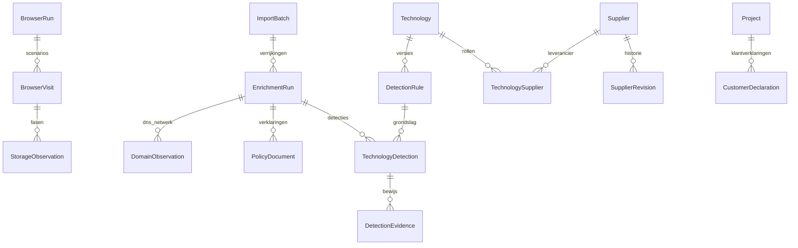

# Stap 3 — technologie, toestemmingsscenario’s en leveranciers

Gerealiseerd op 3 november 2026. De projecttab **Technologie & privacy** ontsluit
technologieherkenning, DNS/netwerkwaarnemingen, verklaringen en een afzonderlijk
profiel van Europese uitgeversafhankelijkheid. Iedere voltooide browserbatch
start automatisch een achtergrondverrijking. Ook bestaande browserbatches kunnen
vanuit deze tab opnieuw worden verrijkt. De oorspronkelijke crawl blijft intact.

## Toestemmingsonderzoek

Schakel bij het starten van browseronderzoek de optionele privacycontrole in.
Er komen vier onafhankelijke browsercontexts per URL: geen keuze, weigeren,
accepteren en accepteren gevolgd door intrekken. Maximaal 25 URL’s/100 visits,
met dezelfde host-, robots-, request- en bytegrenzen als het browseronderzoek.
Ieder scenario heeft eigen artefacten, resources, opslagmetadata en bronrecord.
Linkcontroles vergelijken doelpagina’s binnen hetzelfde scenario.

Herkenning ondersteunt zichtbare bedieningselementen van OneTrust, Cookiebot,
Complianz en Didomi, plus beperkte knoplabels binnen consentcontainers. Eigen
CSS-selectors kunnen expliciet worden opgegeven. Geen gevonden knop, mislukte
interactie of niet vastgestelde wijziging blijft onbekend/onvolledig. Er is geen
bewijs van geldige toestemming uitsluitend doordat een knop is aangeklikt.

Per fase worden cookienamen, domein, pad, vervaldatum, Secure/HttpOnly/SameSite
en local-/sessionStorage-sleutels met lengtes opgeslagen. **Waarden worden niet
opgenomen in deze waarnemingen.** Tijdens deze optionele controle bewaart alleen
de tijdelijke browsercontext cookiewaarden en geeft de broker ze door aan de
bijbehorende gevalideerde GET-requests. Native Chromium behandelt Set-Cookie,
inclusief HttpOnly. Na ieder scenario wordt de context vernietigd. Baselineonderzoek
blijft zonder cookieforwarding. Autorisatieheaders worden niet doorgestuurd.

Querywaarden in opgeslagen request-URL’s en console-/JavaScript-foutteksten worden
bij privacyonderzoek geredigeerd. Oorspronkelijke HTML, DOM en screenshots blijven
bronbewijs en kunnen gegevens bevatten die de onderzochte site daarin opneemt;
zij zijn geen integraal geanonimiseerde kopieën. Bewijs is uitsluitend bereikbaar
binnen het project. HTML-downloads zijn bijlagen met nosniff en beperkende CSP.

Opslagobservaties zijn begrensd: 300 cookies, 20 frames, 200 sleutels per opslagtype
per frame en 1.000 waarnemingen per fase. Afkapping of ontoegankelijke opslag maakt
de scenariodekking onvolledig. POST, service workers en websockets blijven geblokkeerd.
Daardoor kan server-side tracking of een CMP dat POST vereist niet volledig worden
onderzocht; een geblokkeerde poging bewijst geen doorgifte. De meting beslaat een
korte observatieperiode, geen langdurige gebruikssessie.

## Herkenning en bewijs

De startcatalogus bevat 48 technologieën en 83 versieerbare regels: CMS, zichtbare
plugins, frameworks, analytics, advertenties, CRM/marketingwidgets, CMP’s, chat,
betalingen, embeds, CDN, hosting en DNS/mailproviders. Bronnen zijn generator-meta,
assetpaden, een beperkte veilige selectie JavaScript-globals, serverheaders,
cookienamen, daadwerkelijk opgevraagde resourcehosts/-paden, DNS en ASN.
Hostherkenning controleert domeingrenzen; een domein dat alleen de merknaam bevat
is onvoldoende. Geen uitvoering van zelf aangeleverde detectiecode/regex.

Een detectie onderscheidt waargenomen request, geblokkeerde poging, cookie en
indirecte aanwijzing. Versies komen alleen uit expliciete bronindicaties. De
bewijsketen bewaart regelversie, meetmoment, scenario/fase en verwijzingen naar
bronrecord, browserartefact, resource of DNS-waarneming. Een HubSpot-widget bewijst
niet dat HubSpot het centrale CRM is; onzichtbare plugins blijven onbekend.

Per verrijking maximaal 2.000 detecties, 30 hosts, DNS A/AAAA/CNAME/MX/TXT/NS en
maximaal twee publieke IP’s per host voor RIPEstat ASN/prefix. Niet-publieke
DNS-antwoorden worden nooit voor netwerkfetches gebruikt. DNS/ASN-uitval en
budgetafkapping staan expliciet bij de dekking. Een CDN kan de origin afschermen;
ASN of edge-IP geeft geen bewezen fysieke gegevenslocatie.

Maximaal twee gevonden privacy-/cookieverklaringen binnen de toegestane hosts
worden apart opgehaald zonder scenario-cookies en met checksum bewaard. Ontbrekende
tekst of een niet gevonden productalias is een beoordelingssignaal, geen bewijs
van een ontbrekende of juridisch ontoereikende verklaring.

## Opslagmodel

Identiteit, project/batch, technologie, fase en foreign keys zijn relationeel en
geïndexeerd; variabele DNS-antwoorden, dekking en bewijssnapshots zijn JSONB.
Binaire bewijsstukken blijven in PostgreSQL. Detecties zijn idempotent op een
fingerprint; run/batchversie, run/host en regel/versie zijn uniek. Achtergrondtaken
verwerken één DNS-host per taak en hervatten bestaande waarnemingen. Regel-ID’s
worden bij de eerste uitvoering vastgelegd. Afgeronde runs blijven bewaard;
opnieuw verrijken maakt een nieuwe run. Verwijderen van de browserbatch verwijdert
de bijbehorende verrijkingen; de gedeelde catalogus blijft bestaan.

Het gedeelde leveranciersregister bevat 22 uitgevers. Zeven landen zijn voorzien
van bron en controledatum; overige landen en alle nog niet geverifieerde
moederlanden blijven onbekend. Alleen systeembeheerders wijzigen dit register,
met nieuwe revisie. Een detectie bewaart een leverancier-snapshot: latere wijzigingen
herschrijven historische resultaten niet. EU betekent hier EU-27; uitgeversland,
moederland, contractpartij en gegevenslocatie zijn verschillende gegevens.

Projectbewerkers kunnen afzonderlijke klantverklaringen toevoegen over gebruik,
centraal CRM, contractpartij, gegevenslocatie of bewaartermijn. Ze bewaren auteur
en datum en overschrijven geen automatisch waargenomen feiten. Het profiel telt
EU-, niet-EU- en onbekende uitgevers; het geeft **geen AVG-conformiteitsscore**.

Lezers kunnen inventaris, bewijs, register en JSONL-export bekijken. Bewerkers
starten/hervatten onderzoek en voegen verklaringen toe. Alle endpoints controleren
projecttoegang; mutaties gebruiken POST en CSRF. Export bevat detecties met bewijs,
leverancierssnapshots, DNS, opslagmetadata, beleidsdocumentmetadata en afzonderlijk
aangeduide actuele klantverklaringen.

## Validatie en bronnen

`ops/checks/privacy_engine_probe.py` controleert alle vier scenario’s met native
Chromium en synthetische antwoorden, inclusief verse contexts, geverifieerde
bediening, HttpOnly-cookieforwarding en geredigeerde opslag. De live testcontrole
`ops/checks/browser_runtime_smoke.py` doorloopt daarnaast queue, database,
verrijking en UI met example.com en ruimt tijdelijke gegevens op. Alleen sem_test.

- [Playwright browsercontexts en cookies](https://playwright.dev/python/docs/api/class-browsercontext)
- [AP: trackingcookies](https://autoriteitpersoonsgegevens.nl/themas/internet-slimme-apparaten/cookies/trackingcookies)
- [RIPEstat network-info](https://stat.ripe.net/docs/data-api/api-endpoints/network-info)

Bronnen en controledatums van individuele uitgevers staan in het register en
`site_intelligence/data/catalog-v1.json`.

Validatie op sem_test: alle **324 Django-tests** slagen; migratiecontrole geeft
geen ontbrekende migraties. De native browserproef slaagt voor alle vier scenario’s.
De live ketencontrole met example.com slaagt, inclusief drie analyses, DNS-verrijking,
leveranciersregister en bewijsdownloads. Tijdelijke gegevens zijn verwijderd.
App, browser en workers zijn op test bijgewerkt. Productie is niet gewijzigd.
