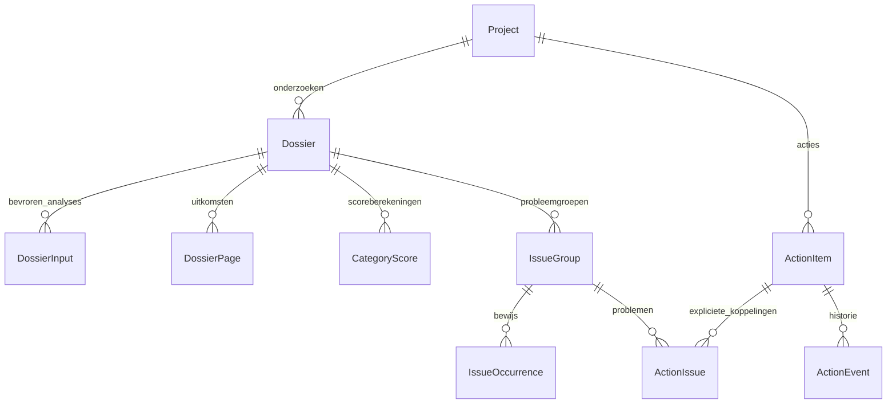

# Stap 5 — onderzoeksdossier, scores, bewijs en acties

De projecttab **Onderzoeksdossier** combineert een gepubliceerde webcrawl met een
optioneel browseronderzoek dat bij diezelfde crawl hoort. Een bewerker kiest de
metingen en maakt een dossier. Een achtergrondtaak bouwt de presentatie op zonder
de website opnieuw te bezoeken. Lezers bekijken dossiers, bewijs, acties en exports.

## Presentatie

Het dossier toont vijf categorieën:

1. **Techniek & indexeerbaarheid**: HTTP, redirects, robots, canonicals, hreflang,
   technische linkdoelen, JSON-LD-syntaxis en waargenomen beveiligingsheaders.
2. **Content & structuur**: metadata, headings, taal, exacte duplicaten en interne
   ondersteuning binnen de onderzochte dataset.
3. **Gebruikerservaring & toegankelijkheid**: assets en automatische browsercontroles.
   De selectie van browser-URL’s staat expliciet bij de resultaten.
4. **Privacy & toestemming**: status en dekking van vier toestemmingsscenario’s;
   technische signalen vragen interpretatie, geen automatische juridische score.
5. **Technologie & afhankelijkheid**: geïnventariseerde technologieën en een afzonderlijk
   profiel van Europese uitgevers, onbekende leveranciers en onbekende moederlanden.
   Dat zijn geen bewezen contractpartijen of gegevenslocaties.

Technische scores, probleemgroepen en acties zijn verschillende gegevens. Een
bewuste acceptatie of gewijzigde zakelijke prioriteit herschrijft geen score.
Er is geen totaalscore. Diagnostische browserlaadtijden worden geen veld-CWV-score.
GA4/GSC/Ahrefs bepalen in deze versie nog niet automatisch de zakelijke prioriteit.
Klantverklaringen blijven afzonderlijk herkenbaar en worden bij aanmaak bevroren.

## Scoremodel `report-v1`

De eerste drie categorieën gebruiken een vaste catalogus van verwachte controles.
Techniek/content gebruiken de webcrawl; gebruikerservaring gebruikt de expliciet
gekozen browserselectie. Zonder browseronderzoek verschijnt daarvoor geen cijfer.

Per genormaliseerde URL en controle telt maximaal één uitkomst. Bij verschillende
uitkomsten voor dezelfde URL geldt conservatief: signaal vóór onbekend vóór geslaagd
vóór niet-toepasselijk. Technische controles met de expliciet aangewezen hoge impact
wegen 3, andere controles 1; de volledige catalogus staat in `reporting/catalog.py`.
De weging is een productkeuze, geen wetenschappelijk bewezen effect op bedrijfsresultaat.

```text
dekking = (geslaagd + signaal) / (geslaagd + signaal + onbekend)
score   = 100 × gewogen geslaagde URL-controles / gewogen toepasselijke URL-controles
```

Onbekend levert nul punten op en blijft apart zichtbaar. Niet-toepasselijk valt
buiten teller en noemer. Onder werkelijk 80% dekking verschijnt geen cijfer; alleen
de getoonde percentages worden afgerond. Als niets van toepassing is, volgt geen
100 maar de status niet-toepasselijk. Afgekapte rapportinvoer onderdrukt cijfers.

Een link die op één URL twintig keer voorkomt veroorzaakt dus geen twintigmaal
scoreaftrek. Een probleem op veel verschillende URL’s beïnvloedt wel de betreffende
URL-controle; de impact per controle blijft begrensd door zijn gewicht. Zowel de
formule als aantallen per controle, gewichten en teller/noemer zijn opgeslagen.
De score is op het scherm per controle uit te leggen en volledig exporteerbaar.

Privacy en technologie krijgen uitsluitend een status/profiel. Ontbrekende
veldmetingen van gebruikerssnelheid blijven een expliciet onbekende controle.
Een hoog cijfer betekent niet dat Google de site indexeert, dat alle inhoud goed
is of dat de site juridisch compliant of volledig toegankelijk is.

## Problemen en bewijs

De navigatie is **categorie → probleemgroep → pagina/waarneming → bron-/doelbewijs**.
Er zijn filters en paginering; op mobiel verschijnen probleem- en actiekaarten.

Groepering `group-v1` gebruikt:

- Dezelfde gemeten bestemming of dezelfde volledige verzameling bestemmingen
  voor 404-/serverfoutlinks en kapotte resources.
- Dezelfde genormaliseerde primaire waarde voor exacte metadata-/tekstduplicaten.
- Dezelfde toegankelijkheidsregel en verzamelde elementselectie.
- Voor overige controles: dezelfde regel, met expliciet nog te beoordelen oorzaak.

Een groep is geen automatisch bewezen hoofdoorzaak. URL-aantal en aantal
waarnemingen blijven afzonderlijk zichtbaar; meerdere scans/scenario’s kunnen
bewijsmateriaal bij dezelfde URL opleveren. Iedere verwijzing blijft aan de
gekozen analyserun gebonden. Eerdere dossiers blijven historische momentopnamen.
Een gebruiker koppelt problemen uit een ander dossier expliciet aan een bestaande
actie; overeenkomstige regels worden niet stilzwijgend als dezelfde opdracht beschouwd.

## Acties en aantoonbaar oplossen

Een actie kan meerdere probleemgroepen bundelen en heeft een verantwoordelijke,
zakelijke prioriteit, inspanning, acceptatiecriterium en status:

`Te beoordelen → Gepland → In uitvoering → Gereed voor controle → Opgelost`

Daarnaast bestaat **Bewust geaccepteerd**, met verplichte motivatie. Alleen
projectbewerkers/beheerders wijzigen acties; toewijzing gaat aan actieve bewerkers.
Wijzigingen, expliciete koppelingen en verificaties krijgen een afzonderlijk,
append-only gebeurtenisrecord. Gelijktijdige wijzigingen worden met een revisietijd
gecontroleerd. Criteria van een opgeloste actie kunnen niet ongemerkt veranderen.

Handmatig een nieuwe actie op Opgelost zetten is niet toegestaan. Verificatie vereist:

- Een afgerond controledossier uit hetzelfde project, zonder ontbrekende invoer of
  rapportafkapping.
- Voor iedere oorspronkelijke URL en relevante controle een werkelijk nieuwere
  meetdatum, in dezelfde onderzoeksscope. Heranalyse van oude HTML telt niet.
- Beschikbare bronrecords, compatibele regelversies en een expliciete geslaagde
  controle. Ontbrekende controles, ontbrekende datums/tijdzones en onbekende waarden
  blijven **Niet opnieuw gemeten**.
- Geen resterende signalen in de gekoppelde probleemgroepen.
- Bevestiging door de bewerker dat ook de acceptatiecriteria zijn gecontroleerd.

Een ontbrekende bevinding is op zichzelf dus geen bewijs van oplossing. Een nieuwe
regelversie vereist herbeoordeling; er is geen impliciete compatibiliteitsmapping.
Een nieuw gemeten signaal dat expliciet aan een opgeloste actie wordt gekoppeld,
heropent die actie voor beoordeling. Een bewuste acceptatie verandert de technische
waarneming niet. Verificatie is begrensd tot 20.000 oude waarnemingen; overschrijding
levert geen automatische afmelding op.

## Prospectrapport en export

Het prospectrapport bevat scope, meetdatums, categorieën, maximaal vijf technische
aandachtspunten met een voorbeeld-URL en beknopte gemeten onderbouwing, voorstellen voor vervolg en onderzoeksgrenzen. De selectie sorteert
op technische ernst en geraakt URL-aantal; zij claimt geen berekende omzetimpact.
Het rapport is afdrukbaar en als zelfstandig HTML-bestand te downloaden. PDF kan
via de afdrukfunctie van de browser. Bewijslinks blijven privé en vereisen projecttoegang;
er is geen publieke deel-URL of automatische verzending.

De JSONL-export bevat bevroren invoerreferenties, scoreberekeningen, pagina-uitkomsten,
probleemgroepen, bewijsverwijzingen en afzonderlijk de actuele gerelateerde acties
met hun gebeurtenissen. Het exportmoment voor acties staat in de metadata. Acties
zijn live projectwerk, terwijl metingen en scores van het dossier bevroren blijven.

## Opslag en verwerking



Dossier-/projectidentiteit, URL-hash, scope en relaties zijn getypeerd en geïndexeerd.
Variabele controles, scoreberekeningen en historische onderbouwing zijn JSONB.
Rapportages verwijzen naar origineel bewijs en kopiëren geen HTML-/screenshotbodies.

Bij aanmaak worden de laatste afgeronde relevante analyseruns en de beschikbare
technologie-/klantcontext vastgezet. Een latere heranalyse wisselt deze niet om.
Opbouw is transactioneel en idempotent; alleen een compleet dossier wordt gepubliceerd.
Falen laat bronanalyses intact. Rechten worden bij uitvoering opnieuw gecontroleerd.

Grenzen: 150.000 invoerresultaten, 100.000 waarnemingen en 10.000 groepen per dossier;
velden en bewijs worden in chunks verwerkt. Overschrijding staat bij de dekking en
onderdrukt technische cijfers. De taak heeft 600 seconden zachte en 630 seconden
harde looptijd. Er komen geen nieuwe externe netwerkrequests bij rapportopbouw.

Verwijderen van de primaire crawl verwijdert het dossier. Acties met hun historie
blijven projectwerk. Verwijderen van een browserbron of afzonderlijk bronrecord
laat een historische rapportagesnapshot achter, met waarschuwing over ontbrekend
bewijs. Dat ontbrekende bewijs kan geen nieuwe oplossing bevestigen. Verwijderen
van een project verwijdert ook zijn dossiers en acties.

De nieuwe tabellen zitten in `reporting/migrations/0001_initial.py`. Er is geen
wijziging van productie of automatische GitHub-push onderdeel van deze implementatie.

## Validatie

De schaalproef `ops/checks/report_scale.py` verwerkte 5.000 URL’s en 50.000 herhaalde
bevindingen tot één groep, met 5.000 getroffen URL’s. Dossieropbouw: 4,45 seconden;
inclusief synthetische invoer: 6,10 seconden; 473 queries; 110,8 MiB piek-RSS.
Alle gegevens zijn teruggedraaid, zonder netwerkrequests. Dit is geen SLA voor
maximale datasets.

`ops/checks/report_runtime_smoke.py` controleert op sem_test de echte taakqueue,
bevroren analyseruns, categorieën, bewijs, acties, UI en exports met duidelijk
synthetische waarnemingen. Een extra native Chromium-controle verifieert de
geauthenticeerde desktopschermen, een CSRF-beveiligde actiewijziging en vier
mobiele schermen op 390px zonder horizontale pagina-overloop. Tijdelijke testdata
worden na de controle verwijderd.

De definitieve volledige suite slaagt met **387 tests**. Migratiecontrole en
Django-systeemcontrole slagen. De module is geactiveerd op test; productie is
voor deze stap niet bijgewerkt. De tijdelijke previewprojecten, gebruikers en
sessies zijn verwijderd na de browsercontrole.
